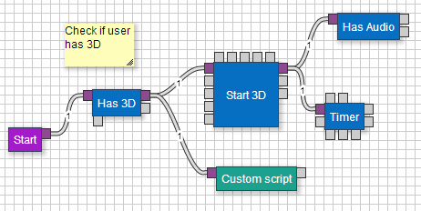
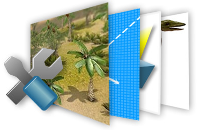

## The Idea
Animate makes the task of building complex web apps much simpler, by giving the user the ability to visualize and 
design the app without needing to code. Through an intuitive online editor, users are able to work together using 
a common visual interface that links different technologies, creating engaging and complex web applications. 
Animate gives teams the opportunity to work together by offering different levels of access for each user. 
Developers can get right into the code while designers, artists or managers can use the interface to build 
the application without knowing the inner mechanics of each behaviour.

Animate also comes with several off the shelf plugins that are built by my startup Webinate 
to kick start the development of a particular application. However for those who still want to code, 
Animate offers intuitive methods for doing just that as well. Although still in development, a beta 
version will be online in the next few months. Webinate is currently using Animate to build and deliver 
web and mobile apps for our clients and continually improve each new release.

## Visual Scripting

Intuitive scripting engine that utilises cutting edge HTML5 and 
JavaScript technologies to visualise the flow of your application. 
Communicate to your teams in the easiest way you can - visually

## Plugins

Built from the ground up to be modular and robust. Numerous plugins are available which offer you 
powerful off the shelf functionality. Simply drag n drop to create eye popping 
applications without touching a line of code.

## Content Management

Powerful content management system that streamlines the storage, 
loading, permissions and deployment of your assets. Share content between projects 
and users on the web, or utilise the ever growing asset library of your fellow Animators.

## Sharing

Full control over sharing your projects with the Webinate community and the world at large. 
Join in conversations, check out the gallery, or post your work on your favourite social network site.