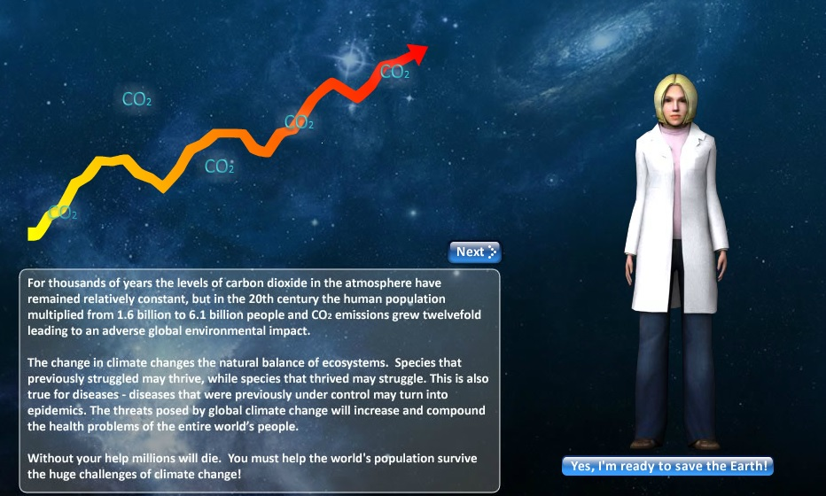
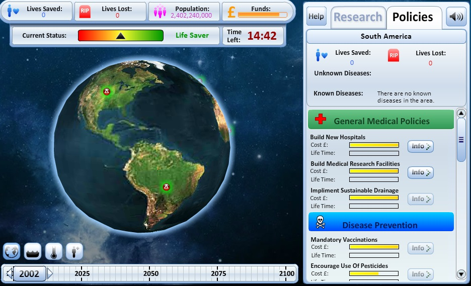
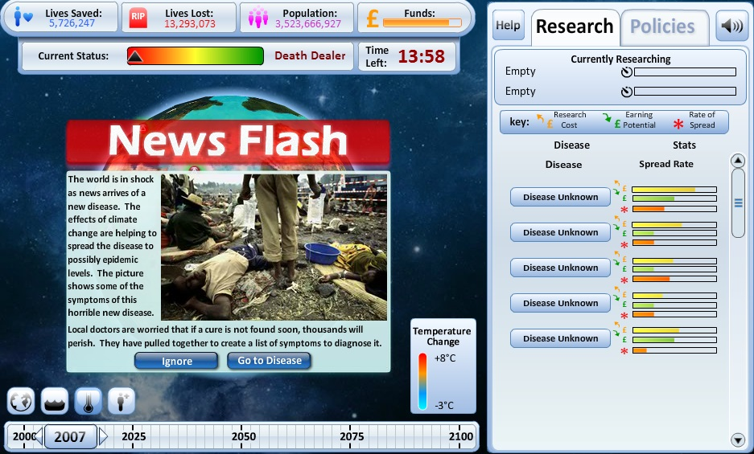

## The idea

Climate Health Impact showed a less familiar side of global warming. As the planet warms,
disease-carrying vectors spread further, and more people fall ill. The game was funded by the
Wellcome Trust.

Players managed health policy over time while the climate changed. Each outbreak called for policy
decisions to limit the damage and save as many people as possible.

## Delivery

The game was built in ActionScript with Flash Builder.

