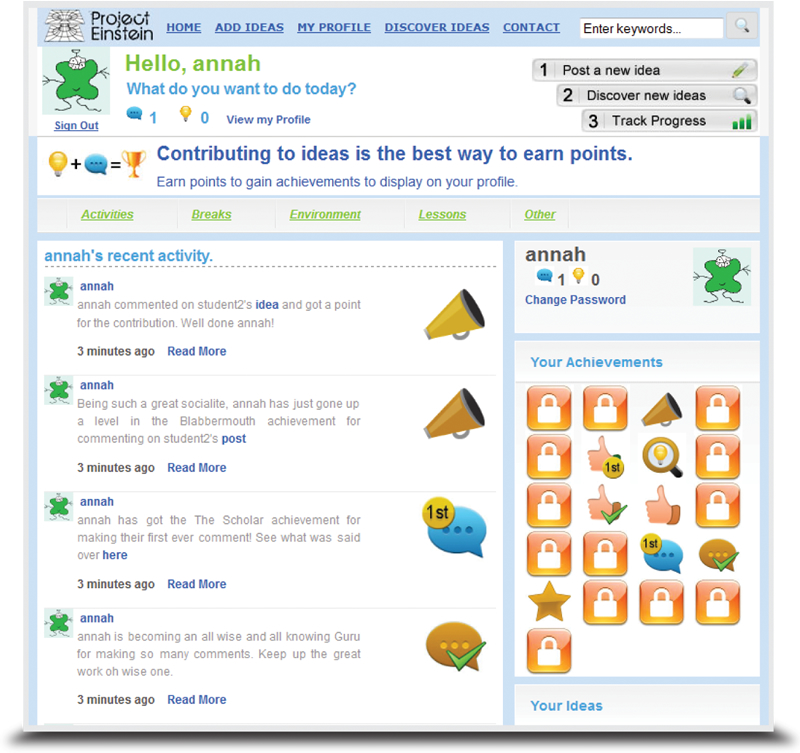

## The idea

Project Einstein was a module for a social website for students. Gamification rewarded the
people who contributed most, to keep the conversation going. It was mainly a research project, to
test whether gamification could improve student engagement on the site.

## Delivery

The module added a gamification back end to the site, and a set of front-end widgets that
connected the site to its users. It was built with PHP, MySQL, AJAX, HTML and CSS.
