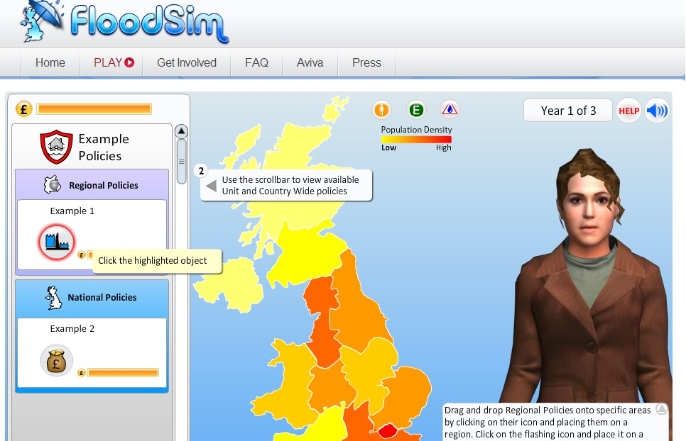
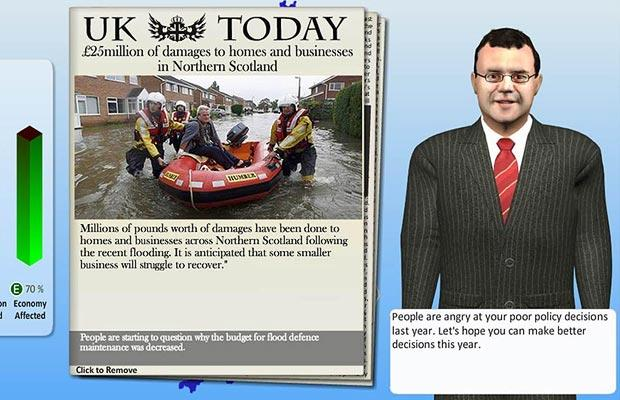

## The Idea

FloodSim gave people the power to choose which policies they wanted to see enacted for a fictional 
number of years. Special advisors gave you guidance on the policies being proposed in the government at the time, 
and helped educate the player on the issues at hand.

FloodSim was hugely successful and was showcased in a number of publications as well as on BBC news. 
My role on the game was lead developer as well as helping with the core design and to a 
lesser degree some work on the art. It was a great challenge and laid the 
framework for my interest in ActionScript.

