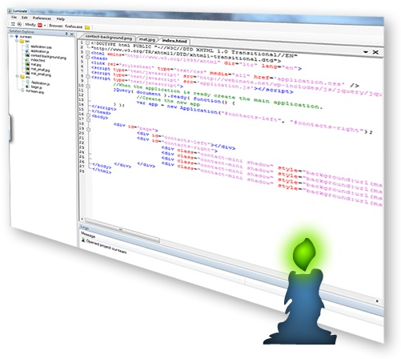

## The idea

Luminate was a project I built for ResearchNow to answer one question: how do you build a complex
JavaScript application? At the time there were no transpilers, and the editors of the day did little to help.
Luminate took the best features of several IDEs and editors, with Notepad++ as the main
inspiration, and combined them into one tool for large JavaScript projects.

## Delivery

Luminate was built on .NET Framework 3. It supported autocomplete, syntax highlighting and an
object-oriented way to structure JavaScript code.

Languages such as TypeScript, Dart and CoffeeScript later solved the same problems, and Luminate
is no longer maintained. The source code is on GitHub.
