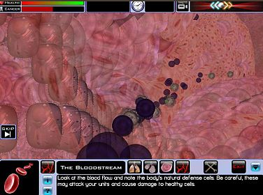

## The Idea

Working very closely with top nano scientists, artists and game designers; 
I helped create a module of the game series ‘NanoMission’. I developed the second of the modules, 
which was a re-creation of a person’s alveoli in the lung. Players would use nano medicine and vesicles 
to carry life saving drugs to cancerous areas of the alveoli.

NanoMission was part of a series of games we did which were about educating children 
on the subject of nanotechnology and perhaps get them to consider taking it up at university. 
It was done in partnership with the Welcome Trust as well as FEI. The game was met with wonderful feedback 
and I took part in a several day showcase of the game, touring many of the UK midland’s town centers. 
NanoMission was developed using C++, Virtools and C#. I led the programming team on both the 3D 
engine as well as the authoring side of the game.

<YouTube id="9bZ4-hIkKp8" title="Nanomission" />