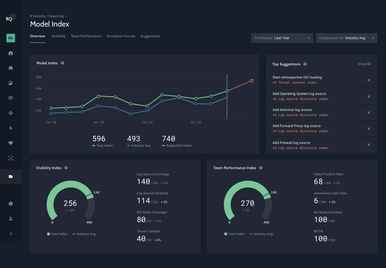

## Overview

ReliaQuest's GreyMatter is an agentic AI platform for security operations (SecOps). It brings
threat detection, investigation and response together across multi-cloud and hybrid enterprise
environments. I worked on parts of the GreyMatter front end.

## Highlights

- Built systems that trawled and analysed the dark web.
- Built complex UI that handled millions of highly sensitive logs and events.
- Worked on projects that explored some of the darker sides of the programming world.