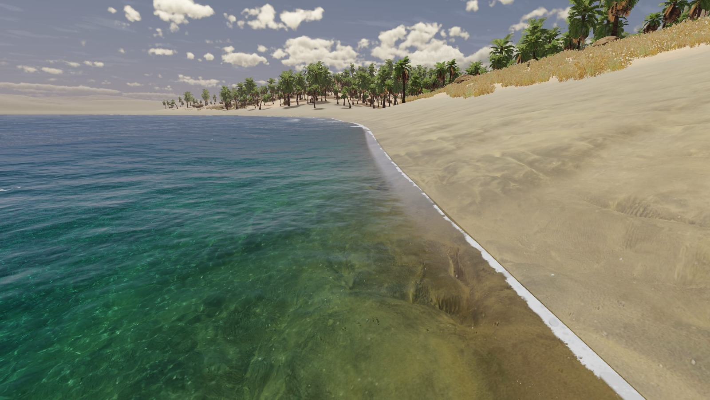
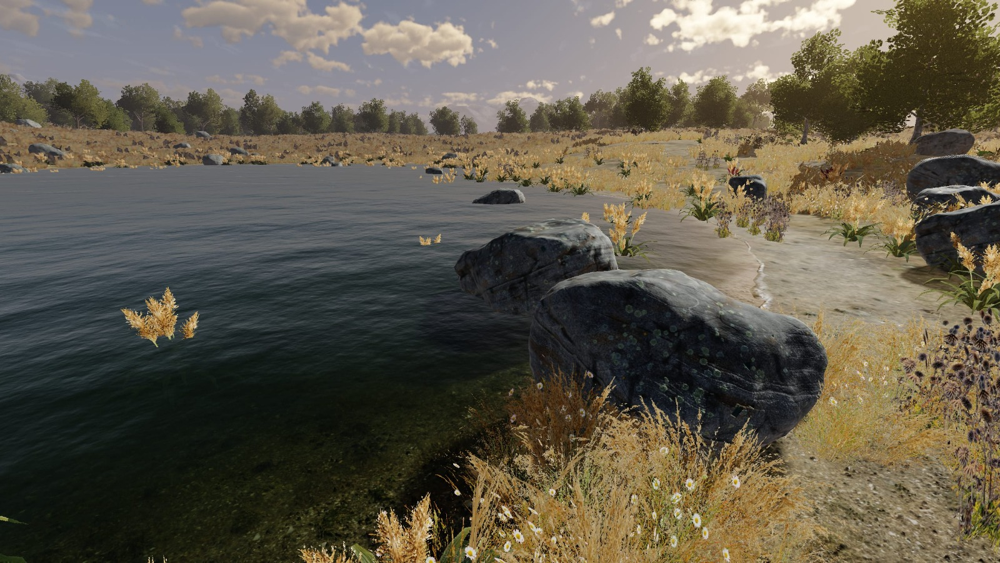
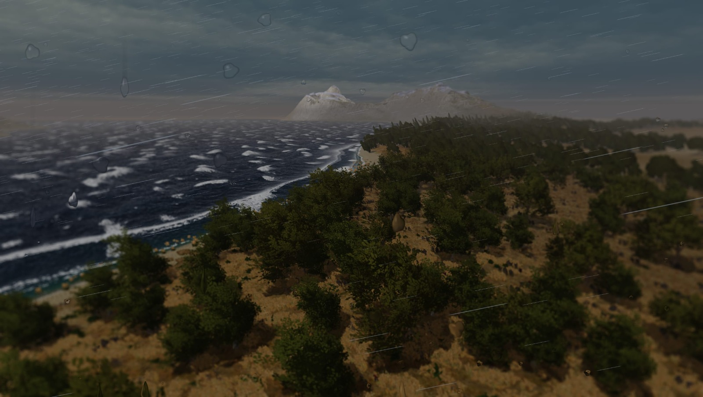

Rewild is a 3D game about time travel and natural history. It runs in the browser on a custom
WebGPU engine, with its own level editor and UI framework.

Every picture on this page is taken in the game. I build Rewild in milestones, each one a system of
the world named after something from nature, and I release new screenshots as each one lands.

## The world

### Water: Pelagic

The world has oceans, lakes, mountain tarns and lagoons. The water moves with the weather, breaks
on the shore, wets the sand and changes the light beneath it. The player can wade, swim and dive.

### Terrain: Strata

The terrain is a procedural, endless heightmap world. It grows from a seed, and you can then shape,
paint and save it in the editor. Biomes follow a climate model of temperature and moisture, so
deserts, grasslands and forests fall where the climate puts them.

### Plants and objects: Understory

Trees, grass, ferns, palms, rocks and pebbles grow across the ground. Objects you place stay on the
ground when you reshape the land beneath them.

### Weather and sky

A day and night cycle drives the weather, which drifts between states over time. The sky is drawn
with volumetric clouds that cast shadows, with rain, snow and lightning on top.

### Sound: Susurrus

The wind rises and gusts, rain patters and drips, and thunder rolls in a moment after the strike.
The sea washes on the beach, and each biome has its own day and night life that changes with the
weather. The player has footsteps, splashes and breath.

### Materials: Lichen

Everything is shaded with one physically based material model, the same metallic-roughness model
that glTF and Blender use, so assets look the same in Rewild as in the tools they were made in.

## Under the hood

- **Renderer:** written from scratch on WebGPU, with WGSL shaders.
- **Editor:** the level editor is built into the game, so the world you edit is the world you play.
- **UI:** a lightweight framework of my own, built on web components with signal-style reactivity,
  in place of React or Vue.
- **Offline first:** you can create and edit levels without an account. A self-hosted backend to
  sync them across devices is in progress.

## Follow along

Rewild is one of my active projects. A dev series on YouTube tracks its progress, so follow me on
my socials to see what comes next.

<YouTube id="9qNyJFmbrgE" title="RE-WILD Dev Diary" />
