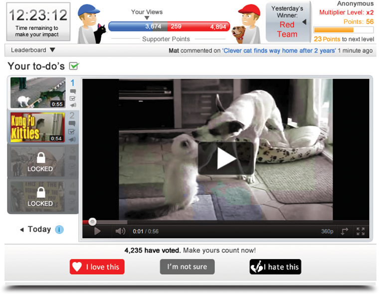

## The idea

The Social Influence platform brought in content from YouTube and gathered the conversations
between groups of people about it, to study social behaviour online.

## Delivery

The platform combined several web technologies. One instance ran on a website for the UK
government. Further details are under a non-disclosure agreement.
