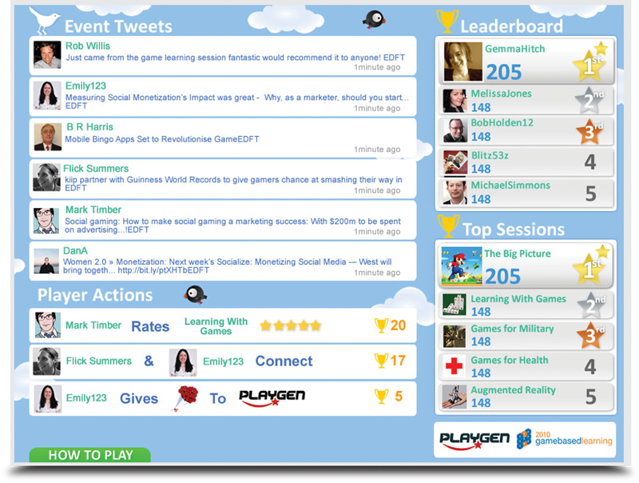

## The idea

Attendees earned points for tweeting about the conference, and climbed the leaderboards as they
did. The aim was to get people talking about the speakers and about each other.

The game also let attendees interact with people they had not yet met in person: a new way to meet
people and spread the news.

## Delivery

The game was built with Flash, AJAX, MySQL and the Twitter API.
