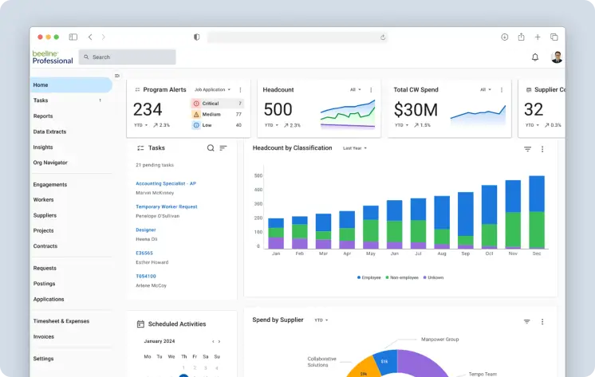

## About Utmost

Utmost was a Dublin-based startup, where I was front-end architect. We built enterprise HR software
focused on vendor management and on business and system workflows. The application had many
standout features for its time, including visual workflow editors, smart-forms, and a flexible,
robust back-end architecture built on Kotlin.

## Acquisition

Beeline later acquired Utmost, and its software became part of the Beeline Professional service.